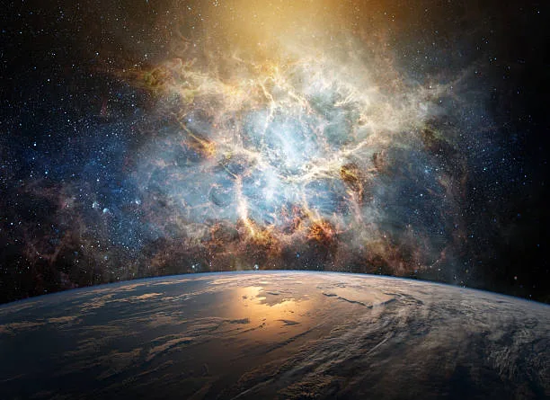

+++
title = "Binding Energy: Why Iron Is the End of the Line"
date = 2025-11-28
description = "Nuclear binding energy explained: mass defect, E = mc², the binding energy curve, and why both fission of uranium and fusion of hydrogen release energy, but iron does not."
draft = false

[extra]
seo_title = "Nuclear Binding Energy and Why Iron Is the End of the Line"
toc = true
og_image = "cover.webp"
+++



## Introduction

There is a question that bothered me for a long time, and I suspect it bothers a lot of people
who have read a little about nuclear energy: if you get energy by **splitting** heavy atoms
(fission), and you also get energy by **joining** light atoms (fusion), how can both be true?
Surely one of them has to cost energy. You can't make money by both buying and selling the same
thing.

The answer turns out to be one of the most elegant ideas in physics, and it all hangs on a single
graph: the **binding energy curve**. Once that curve makes sense, fission, fusion, why stars die,
and why nobody is building iron-burning power plants all fall out of it almost for free.

This post is the foundation for a small series on nuclear physics. You don't need any background
beyond high-school physics and a willingness to accept that mass and energy are the same thing.

## TL;DR

- A nucleus weighs **less** than the protons and neutrons it is made from. The missing mass is the
  **binding energy**, via `E = mc²`.
- Divide that by the number of nucleons and you get **binding energy per nucleon**: a measure of
  how tightly each particle is held.
- That number rises steeply for light nuclei, peaks around **iron and nickel** (~8.8 MeV), and
  slowly falls for heavy nuclei.
- Any reaction that moves nuclei **towards the peak** releases energy. Light nuclei climb by
  fusing; heavy nuclei climb by splitting. Iron is already at the top, so it can do neither.

## The nucleus is lighter than its parts

Start with helium-4, the nucleus of an ordinary helium atom: two protons and two neutrons. Look up
the masses (in atomic mass units, `u`):

| Particle         | Mass (u)  |
| ---------------- | --------- |
| Proton           | 1.007276  |
| Neutron          | 1.008665  |
| 2 protons + 2 neutrons | 4.031883 |
| Helium-4 nucleus | 4.001506  |

The assembled nucleus is lighter than its loose parts by `0.030377 u`. That's not a measurement
error; it's the whole story. This missing mass is called the **mass defect**.

Where did it go? It left as energy when the nucleus formed. Using `E = mc²`, and the handy fact
that `1 u` of mass is equivalent to `931.494 MeV`:

```
0.030377 u × 931.494 MeV/u ≈ 28.3 MeV
```

So 28.3 MeV of energy was released when those four nucleons snapped together, and to pull
helium-4 apart again, you'd have to put those 28.3 MeV **back in**. That's the **binding
energy**. It's the energy debt you'd have to repay to dismantle the nucleus.

To put "MeV" in perspective: a chemical bond, the thing that holds a molecule together and the
thing we break when we burn coal or petrol, is worth a few **eV**. Nuclear binding energies are
in the **millions** of eV. That factor of roughly a million is the whole reason nuclear power
exists.

## Binding energy per nucleon

Total binding energy grows with the size of the nucleus, which isn't very interesting on its own;
of course a bigger nucleus has more glue. The useful number is the binding energy **per nucleon**:
divide the total by the mass number `A` (protons + neutrons).

| Nucleus     | Binding energy per nucleon |
| ----------- | -------------------------- |
| Deuterium (²H) | 1.11 MeV |
| Helium-4    | 7.07 MeV |
| Carbon-12   | 7.68 MeV |
| Oxygen-16   | 7.98 MeV |
| Iron-56     | 8.79 MeV |
| Nickel-62   | 8.79 MeV (the actual record holder, by a hair) |
| Uranium-235 | 7.59 MeV |
| Uranium-238 | 7.57 MeV |

Plot that for every known nucleus and you get the famous curve. In words:

```
 MeV per nucleon
  9 |              Fe  Ni
    |          .·'¯¯¯¯¯¯¯¯¯¯¯¯¯¯¯``'·..
  8 |       .·'                       ``·.  U
    |     .'                              ·
  7 |   He
    |   |
    |  /
    | /
  1 |D
    +------------------------------------------- mass number A
       4      56                          235
```

- A **steep climb** through the light elements (with helium-4 sitting conspicuously high for its
  size, because it is an unusually tight little package).
- A **broad peak** around `A ≈ 56–62`: iron and nickel.
- A **slow decline** all the way out to uranium and beyond.

Higher on the curve means more tightly bound, which means **more stable** and, crucially, **lower
in energy**. Nature, like water, flows downhill in energy. In this graph "downhill" means
"upwards on the curve". Any nuclear reaction that ends with nucleons sitting higher on this curve
releases the difference as energy.

## Why the curve has that shape

The shape isn't arbitrary. It comes from a tug-of-war between two forces.

### The strong force: short-range glue

Protons and neutrons are held together by the **strong nuclear force**. It's ferociously strong,
but it only reaches about one or two femtometres (about the width of a nucleon). Beyond that it
falls off a cliff. So each nucleon effectively only feels its immediate neighbours.

In a tiny nucleus, most nucleons sit on the **surface**, with few neighbours to bond with. They're
under-bonded. As the nucleus grows, a larger fraction of nucleons are buried in the interior with
a full set of neighbours, so the binding per nucleon climbs. That's the steep left side of the
curve.

### Electromagnetism: long-range repulsion

Protons are positively charged and repel each other. Unlike the strong force, the electric force
has **infinite range**: every proton pushes on every other proton in the nucleus, not just its
neighbours.

That means the repulsion grows roughly as `Z²` (with `Z` protons) while the strong-force glue only
grows roughly as `A`. In a small nucleus, the glue wins easily. In a big nucleus, the repulsion
catches up and starts eating into the binding. That's the slow decline on the right side.

### Where they balance

Somewhere around iron and nickel, the benefit of having more neighbours has mostly saturated, and
the cost of proton repulsion hasn't yet become dominant. That's the peak. Iron sits at the sweet
spot between "too small to be well glued" and "too big to hold its own charge together".

## A model you can run: the semi-empirical mass formula

Physicists turned that intuition into an actual formula back in the 1930s. It treats the nucleus
like a drop of charged liquid, which is why it's often called the **liquid drop model**, and it
adds up five effects:

1. **Volume**: every nucleon gets glue from its neighbours (proportional to `A`).
2. **Surface**: nucleons on the surface have fewer neighbours, so subtract something proportional
   to the surface area, `A^(2/3)`.
3. **Coulomb**: subtract the proton–proton repulsion, roughly `Z(Z−1) / A^(1/3)`.
4. **Asymmetry**: nuclei prefer balanced numbers of protons and neutrons (a quantum effect from
   the Pauli exclusion principle), so subtract a penalty for imbalance, `(N−Z)² / A`.
5. **Pairing**: nucleons like to pair up, so even–even nuclei get a small bonus and odd–odd nuclei
   a small penalty.

Here it is in Python:

```python
import math

# Semi-empirical mass formula coefficients, in MeV
A_V, A_S, A_C, A_A, A_P = 15.8, 18.3, 0.714, 23.2, 12.0

def binding_energy(Z: int, A: int) -> float:
    """Approximate total binding energy of a nucleus in MeV."""
    N = A - Z
    volume = A_V * A
    surface = A_S * A ** (2 / 3)
    coulomb = A_C * Z * (Z - 1) / A ** (1 / 3)
    asymmetry = A_A * (N - Z) ** 2 / A
    if Z % 2 == 0 and N % 2 == 0:
        pairing = A_P / math.sqrt(A)
    elif Z % 2 == 1 and N % 2 == 1:
        pairing = -A_P / math.sqrt(A)
    else:
        pairing = 0.0
    return volume - surface - coulomb - asymmetry + pairing

nuclei = {
    "He-4": (2, 4),
    "C-12": (6, 12),
    "O-16": (8, 16),
    "Fe-56": (26, 56),
    "Ni-62": (28, 62),
    "U-235": (92, 235),
    "U-238": (92, 238),
}

for name, (Z, A) in nuclei.items():
    B = binding_energy(Z, A)
    print(f"{name:>7}: {B:8.1f} MeV total, {B / A:5.2f} MeV per nucleon")
```

Output:

```
   He-4:     22.2 MeV total,  5.55 MeV per nucleon
   C-12:     87.8 MeV total,  7.32 MeV per nucleon
   O-16:    123.7 MeV total,  7.73 MeV per nucleon
  Fe-56:    490.6 MeV total,  8.76 MeV per nucleon
  Ni-62:    544.6 MeV total,  8.78 MeV per nucleon
  U-235:   1790.7 MeV total,  7.62 MeV per nucleon
  U-238:   1809.5 MeV total,  7.60 MeV per nucleon
```

Five terms and a handful of constants, and it lands within about half a percent of reality for
iron and uranium. It even finds nickel-62 slightly ahead of iron-56. I find that genuinely
remarkable.

It's also honest about its limits: helium-4 comes out at 22 MeV instead of the real 28 MeV.
Treating four particles as a "liquid drop" is a stretch, and helium-4 is special. Its two protons
and two neutrons fill the lowest quantum shell completely, a bit like a noble gas does with
electrons. That extra stability is why helium-4 shows up everywhere in nuclear physics: as the
product of fusion, as the alpha particle in radioactive decay, and as the ash in the cores of
stars.

## Climbing the curve from both sides

Now the paradox from the introduction dissolves.

### Fusion: climbing from the left

Take light nuclei on the steep left slope and merge them. Hydrogen isotopes (about 1–3 MeV per
nucleon) combining into helium-4 (7.07 MeV per nucleon) is a huge jump upwards. Every nucleon
involved ends up more tightly bound, and the difference comes out as energy. That's what powers
the Sun.

### Fission: climbing from the right

Take a heavy nucleus on the gently sloping right side, like uranium-235 at about 7.6 MeV per
nucleon, and split it into two medium-sized pieces around barium and krypton, at about 8.3–8.5 MeV
per nucleon. Each piece is closer to the peak than the original. The gain is under 1 MeV per
nucleon, but there are about 235 nucleons involved, so it adds up to roughly **200 MeV per
fission**. That's what runs nuclear power stations.

### Iron: already at the top

Iron-56 and nickel-62 sit at the summit. Fuse two iron nuclei and the product is further down the
right slope. Split iron and the pieces are further down the left slope. Either way you have to
**put energy in**. Iron is nuclear ash: there's nothing left to burn.

## Why stars die at iron

This has a dramatic consequence for stars.

A star spends most of its life fusing hydrogen into helium. When the hydrogen in its core runs low,
a sufficiently massive star contracts, heats up, and starts fusing helium into carbon and oxygen.
Then carbon into neon and magnesium. Then oxygen into silicon. Then silicon into iron. Each stage
climbs a little further up the curve, releases a little less energy per nucleon, and burns faster.
In the most massive stars, the final silicon-burning stage lasts about a day.

Then the core is iron, and the climb is over. With no more energy being released to hold up the
weight of the star, the core collapses in under a second. The result is a **core-collapse
supernova**, leaving behind a neutron star or a black hole.

Every element heavier than iron, including the gold in your jewellery and the uranium in a
reactor, had to be made by processes that **absorb** energy, such as rapid neutron capture during
supernovae and neutron-star mergers. In a real sense, when we split uranium in a power plant, we're
releasing energy that was stored in it by a stellar catastrophe billions of years ago.

## Conclusion

The binding energy curve is one of those diagrams that rewires how you see the world. A few things
I'd take away from it:

- **Mass is energy.** The nucleus is lighter than its parts, and that missing mass is real,
  measurable energy.
- **Nuclear energy is about a million times denser than chemical energy**, because nuclear binding
  is measured in MeV while chemical bonds are measured in eV.
- **Fission and fusion aren't opposites**. They're two routes up the same hill, approaching from
  opposite sides.
- **Iron is the top of the hill**, which is why stars that make iron are about to die.

In the next two posts I'll take each side of the hill in turn: first [fission](@/blog/nuclear-fission-how-splitting-an-atom-powers-a-city/index.md), the one we've had
working for over 80 years, and then [fusion](@/blog/nuclear-fusion-why-building-a-star-on-earth-is-so-hard/index.md), the one we've been chasing for nearly as long.
