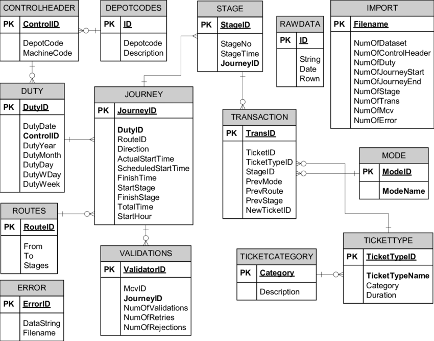

+++
title = "How to generate an ERD for your Database with Python in seconds"
date = 2025-11-06
description = "Generate an entity-relationship diagram (ERD) of your database in seconds with Python and eralchemy2, plus fixes for common Graphviz install issues on macOS."
draft = false

[extra]
seo_title = "Generate an ERD for Your Database with Python"
toc = true
og_image = "cover.webp"
+++


*Scenic Mountain picture by **TERADAT SANTIVIVUT***

## TL;DR

- Install `eralchemy2` (*if you have an issue in this step, visit the solution at the bottom*)
- Import `render_er` function from `eralchemy2` package
- (Optional) Replace `+asyncpg` in your DB URL if you’re using async database connection.
- Call `render_er()` to generate a `.png`. It takes two parameters: your database connection string and the string path to save the image to.
- Admire your handiwork.

## Introduction

An **Entity–Relationship Diagram (ERD)** is a type of data modeling diagram used to visually represent the structure of a database. It illustrates the entities (tables) within a system, their attributes (columns), and the relationships that exist between them. ERDs are commonly used during the design phase of database development to provide a high-level understanding of how data elements interact and are organized.

The concept of ERDs was first introduced by **Peter Chen** in 1976 as part of the Entity–Relationship model, which aimed to create a more natural and conceptual view of data. Over time, ERDs have become a standard tool in database design and are widely supported by modern database management and modeling software.

An ERD typically consists of three primary components:

1. **Entities**—Represented as rectangles, entities correspond to database tables that store specific data objects (e.g., `Users`, `Orders`, `Products`).
2. **Attributes**—Represented as ovals or listed within entities, these describe the properties of each entity (e.g., `id`, `name`, `email`).
3. **Relationships**—Represented as lines connecting entities, these indicate how data in one table relates to data in another, often defined through primary and foreign keys.

ERDs are used by software engineers, database administrators, and data analysts to communicate the logical structure of databases, ensuring clarity, consistency, and efficient system design. They play an essential role in both **conceptual** and **physical** database modeling, bridging the gap between abstract data theory and practical implementation.

### Example of ERD Diagram



*A sample ERD*

### Why This Matters

In modern data-driven apps, your schema is a living thing; constantly evolving. An ERD keeps it **visible**,** understandable**, and** collaborative**.

As developers, we spend too much time spelunking through migrations and table definitions. Let’s give our eyes a break; and our diagrams some love.

### Script to Generate ERD

```python
from app.settings import Settings
from eralchemy2 import render_er

# i prefer to load my environment variables with Pydantic-setting BaseSetting Model
settings = Settings()

SYNC_DATABASE_URL = settings.DATABASE_URL.replace("+asyncpg", "")

render_er(SYNC_DATABASE_URL, 'erd_from_sqlite.png')
```

After running this script, an new image file will be created with the name you passed the second argument to the `render_er` function.

### Common Tips & Pitfalls

- **Async Database URL** won’t work with `eralchemy2` as at the time of writing this.
- **If nothing shows up:** Make sure your database is accessible and populated with actual tables.
- **SQLite quirks:** If you’re using SQLite in-memory (`sqlite:///:memory:`), it won’t persist for introspection. Use a file-based or external DB instead.
- **Make it part of CI:** Automate ERD generation so your team always has an up-to-date schema map.

**Common Issue with Installing Graphviz on macOS**\
Sometimes when installing, there is an issue with the installation.

**Solution**

```bash
export C_INCLUDE_PATH="$(brew --prefix graphviz)/include/"
export LIBRARY_PATH="$(brew --prefix graphviz)/lib/"
pip install --use-pep517 --config-setting="--global-option=build_ext" pygraphviz
```

### Final Thought

With just a few lines of Python, you can turn your database schema into a visual map; a living portrait of your data’s architecture. A simple tool, a tiny script, but then the structure of your data model can be communicated more visually.
