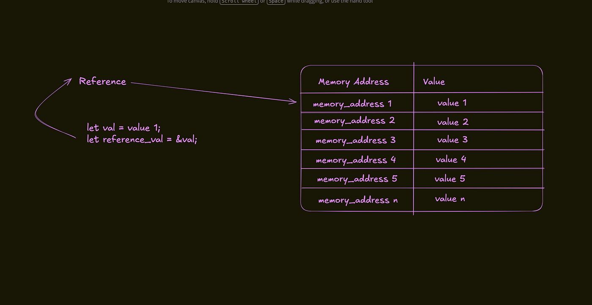
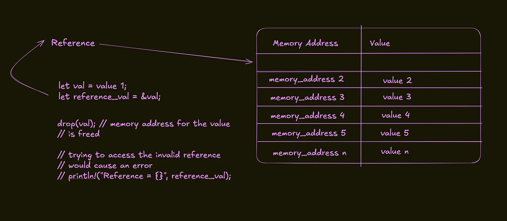

+++
title = "I Finally Understand References and Lifetimes in Rust"
date = 2026-01-31
description = "References and lifetimes in Rust explained: how borrowing and ownership work, what lifetime annotations mean, and how lifetime elision keeps code clean."
draft = false

[extra]
toc = true
og_image = "cover.jpg"
+++


## Introduction

I have been learning and working with Rust for over a year now, and for most of that time, I felt as if I understood references and how to use them. However, for lifetimes, I made a conscious effort not to get my life entangled with that concept. It wasn’t until recently that I gained a new perspective on them that they finally made sense. Understanding these concepts has been pivotal not just in writing correct code, but also in grasping why Rust’s memory guarantees provide safety and performance.

## Understanding References in Rust

References are pointers to a value or part of data; they don’t store the data themselves, just the pointer to where the data is stored in memory (they store the address of another item in memory). This distinction is crucial for understanding how to manage memory safely in Rust.



From the image above, val is a variable that holds the value 1. Taking a reference to that variable stores the address of val in another variable.

## Validity of References

When you create a reference to a value, that reference should only be valid until that value is freed or changed. When the freeing of the value occurs, it is dropped from memory, and that memory address is no longer valid for that value. Consequently, that reference is also invalidated.

- Attempting to use a reference after its associated value has been dropped leads to a compiler error.
- Furthermore, if the value is changed, the memory address of that value can also change.

This is especially common for values stored on the Heap, where memory management is dynamic and subject to change. Rust’s compiler enforces these rules, ensuring that all references remain valid during their lifetime.



## Lock-on Behavior of References

Valid references can be thought of as lock-on values that, when acquired, ensure that the underlying value is accessed only in read-only mode.

- If you want to modify that value, the original reference must be mutable, enabling you to change the underlying data.
- Moreover, if the memory address of the original value is changed—either due to reallocation or modification—the reference will become invalid. Accessing it afterwards will result in a compiler error.

This behavior reinforces Rust’s objectives of safe concurrency by preventing dangling references—references that point to a memory location that has already been freed.

## Technical Deep-Dive: The Ownership Model in Rust

## Key Concepts of Ownership

Rust employs an ownership model that is central to its design and memory safety guarantees.

- Each Value has an Owner: Each value in Rust is associated with a variable that acts as its owner.
- Single Ownership: There can only be one owner of a value at any given time. This guarantees that when the owner goes out of scope, the value is dropped, thereby preventing memory leaks.

## Ownership and Memory Management

This unique model fosters straightforward memory management without the need for a garbage collector. The compiler and ownership rules ensure that memory is reclaimed as soon as it is no longer needed, leading to high performance and zero overhead in most cases.

### Example Code: Ownership and Scoping

```rust
fn main() {
    let string_value = String::from("hello");
    
    {
      let greetings = String::from("Hello there!"); // greetings is valid in this scop
    } // greetings is no longer valid once we exit this scope.

    let mut name = String::from("Brian");
    name.push_str(" David");
    println!("Name: {}", name);
}
```

In this example, `greetings` is a temporary variable that goes out of scope, thereby freeing its associated memory. Meanwhile, the `name` variable retains ownership of its data until it goes out of scope.

## Technical Deep-Dive: References & Lifetimes

## What are Lifetimes?

Lifetimes in Rust ensure that references are valid for as long as they need to be. Every reference in Rust has a lifetime, signifying the scope within which that reference is valid.

### Rules of Lifetimes:

- Each Reference has a Lifetime: This signifies how long the reference is valid in relation to the data it points to.
- No Dangling References: The Rust compiler checks that all references remain valid at compile time, thus preventing any accidental use of dangling references.

## Using Lifetimes in Function Signatures

When functions take references as parameters, it is crucial to indicate the relationship between the lifetimes of the input and output references using lifetime annotations.

### Example Code: Function with Lifetime Annotations

```rust
fn longest<'a>(s1: &'a str, s2: &'a str) -> &'a str {
    if s1.len() > s2.len() {
        s1
    } else {
        s2
    }
}
```

In this example, `'a` indicates that both input references must live at least as long as the returned reference. These annotations allow the Rust compiler to enforce correct memory management rules.

## Advanced Concepts: Lifetime Elision

Rust also employs lifetime elision, which simplifies writing functions by allowing the compiler to infer lifetimes based on specific patterns. This means you can often omit lifetime annotations in straightforward cases, allowing for cleaner and more concise code.

### Example Code: Lifetime Elision in Practice

```rust
fn first_word(s: &str) -> &str {
    let bytes = s.as_bytes();
    for (i, &item) in bytes.iter().enumerate() {
        if item == b' ' {
            return &s[0..i]; // Return a slice of the string
        }
    }
    &s[..] // Return the entire string if no space was found
}
```

In the above code, the compiler can infer that the returned reference has the same lifetime as the input `s`, thereby avoiding the need for explicit annotations.

## References and Lifetimes in Structs

Using references dynamically in structs can complicate things, especially when you want to ensure that the struct does not outlive the references it holds.

### Example Code: Struct with Lifetimes

```rust
struct Book<'a> {
    title: &'a str,
    author: &'a str,
}

fn main() {
    let title = String::from("Rust Programming");
    let author = String::from("Jane Doe");
    let book = Book {
        title: &title,
        author: &author,
    };
    println!("Book Title: {}, Author: {}", book.title, book.author);
}
```

In this example, the `Book` struct contains references to `title` and `author`. The lifetimes specified through the struct ensure that these references live at least as long as the `Book` instance itself.

## Borrowing Mutably vs. Immutably

In Rust, when you borrow a value, you can choose to do so immutably or mutably, and this choice has significant implications for lifetimes and references.

### Example Code: Immutable and Mutable Borrowing

```rust
fn main() {
    let mut value = 10;

    let ref1 = &value; // Immutable borrow
    // let ref2 = &mut value; // Error: cannot borrow `value` as mutable because it is also borrowed as immutable
    println!("Immutable Reference: {}", ref1);
    let ref2 = &mut value; // Mutable borrow after immutable borrow ends
    *ref2 += 5; // Modifying the value through mutable reference
    println!("Modified Value: {}", ref2);
}
```

In this case, you can see how immutably borrowing `value` prevents you from getting a mutable reference until the immutable reference goes out of scope.

## Technical Deep-Dive: Common Pitfalls When Working with References and Lifetimes

Working with references and lifetimes can lead to some common issues, particularly for those new to Rust. It’s essential to be aware of these pitfalls to effectively manage memory and prevent compiler errors.

## Dangling References

Creating a reference to a local variable can cause dangling references. When the local variable goes out of scope, the reference to that variable remains, leading to potential undefined behavior if accessed.

### Example Code: Dangling Reference

```rust
fn create_dangling_reference() -> &String {
    let str = String::from("Dangling Reference");
    &str // Error: return of reference to local variable `str`
}
```

The above code will raise a compile-time error because `str` is dropped at the end of the function, leaving the returned reference dangling.

## Lifetimes Mismatch

Another common issue arises when the lifetimes of references provided to a function do not match the expected lifetimes defined in function signatures. This can lead to confusion and compiler errors.

### Example Code: Lifetime Mismatch

```rust
fn incorrect_lifetime<'a>(s1: &'a str, s2: &str) -> &'a str {
    if s1.len() > s2.len() {
        s1
    } else {
        s2 // Error: the returned reference may not outlive `s2`
    }
}
```

In this case, the function attempts to return a reference from `s1`, tied to a specific lifetime `'a`, while `s2` does not have that constraint.

## Borrow Checker Confusion

Rust’s borrow checker enforces strict rules for borrowing, which can lead to misunderstandings for new programmers. Understanding when ownership transfers and when immutability or mutability can be used is critical.

### Example Code: Borrow Checker Issues

```rust
fn main() {
    let mut number = 10;
    let reference1 = &number; // Immutable borrow
    let reference2 = &mut number; // Error: cannot borrow `number` as mutable due to previous immutable borrow
    println!("Number: {}", reference1);
}
```

The compiler will generate an error when trying to create a mutable reference while an immutable reference still exists.

## Conclusion

Navigating through references and lifetimes in Rust can seem overwhelming at first. However, the language’s design promotes safety and concurrency without a garbage collector. Understanding the ownership model, the nature of references, and how lifetimes work paves the way for better coding practices in Rust.

By learning these concepts, my confidence in leveraging Rust’s memory guarantees has greatly improved. Rust encourages developers to think critically about memory usage, leading to highly efficient programs that are safe from unexpected behavior.

If you want deeper insights into Rust’s memory model, I recommend checking out the official Rust documentation and exploring the various use cases of references and lifetimes. For practical Rust examples, you can refer to the Rust Book for a comprehensive understanding and practical implementation.

The combination of references, lifetimes, and the ownership model forms the backbone of Rust’s memory safety and performance. While challenging at first, mastering these concepts leads to robust and efficient Rust code that stands the test of time, makes concurrent programming easier, and ultimately, enhances the developer experience.
