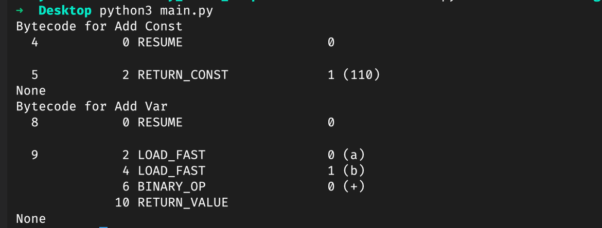

+++
title = "Mastering Python Performance: The Small Tweaks That Make Big Speed"
date = 2026-01-30
description = "The Developer’s Guide to Blazing Fast Python."
draft = false

[extra]
toc = true
og_image = "cover.jpg"
+++


## Introduction

In the realm of software development, writing functional code is often just the beginning. The delicate balance between efficiency, execution duration, and code complexity can make or break your software, particularly in performance-critical applications. For instance, in algorithmic trading, microsecond differences can determine profitable entries. In this guide, you will acquire a comprehensive mental model for optimizing your Python code and learn how to extend this knowledge to enhance your applications’ overall performance.

## TL;DR

If you are looking for quick pointers to boost your Python code efficiency, check out the key topics below or jump to specific sections:

- Favor constants over variables
- Utilize sets for efficient look-ups
- Leverage built-in constructs for optimization
- Explore memory management techniques
- Understand algorithm complexity
- Optimize I/O-bound operations
- Employ multi-threading and parallel processing

## Core Performance Principles

### Favor Constants Over Variables

While variables may enhance code readability, every time a variable is accessed, the Python interpreter must load the value from memory. Constants, in contrast, can be accessed directly, which introduces a speed advantage.

```python
import dis

def add_const():
    return 10 + 100

def add_var(a, b):
    return a + b


print("Bytecode for Add Const")
print(dis.dis(add_const))
print("Bytecode for Add Var")
print(dis.dis(add_var))
```



In this simplified example, even though the efficiency gains by using constants may seem trivial, understanding these nuances can significantly influence code structure. The key lies in systematically using constants where appropriate while ensuring readability is not compromised. Constants reduce the overhead associated with variable lookups, thereby contributing to more efficient execution times.

### Use Sets for Lookups

When your code requires frequent membership tests (checking if a value exists in a collection), sets outpace lists and tuples significantly due to their underlying hash table implementation.

```python
# Using a list for lookups
my_list = list(range(100000000000))
if 2000000 in my_list:
    print("Found!")

# Using a set for lookups
my_set = set(range(100000000000))
if 2000000in my_set:
    print("Found!")
```

Sets deliver O(1) average time complexity for look-up operations, making them the ideal choice for performance-critical applications. By using sets, you can avoid the linear time complexity associated with lists. This efficiency can make a substantial difference in applications where repeated lookups occur in a large dataset.

### Leverage Built-In Constructs for Optimization

Another crucial aspect of writing efficient Python code involves leveraging built-in constructs that Python provides out of the box. Python’s standard libraries, including functools, itertools, and collections, contain optimized implementations that can enhance performance.

### Using `functools.lru_cache` for Caching

One of the simplest yet highly effective optimizations involves caching results of function calls that are expensive to compute using `lru_cache`.

```python
from functools import lru_cache

@lru_cache(maxsize=None)
def fibonacci(n):
    if n < 2:
        return n
    return fibonacci(n - 1) + fibonacci(n - 2)
print(fibonacci(30))  # Efficiently computed using caching
```

By applying caching, you avoid redundant computations, which can save considerable time, particularly in recursive algorithms.

### Technical Deep-Dive Sections

### Deep-Dive Section 1: Understanding Python’s Memory Management

### Introduction to Memory Management

Python employs dynamic memory management through its object allocator. Understanding how Python handles memory allocation and garbage collection can equip you with strategies to write more efficient code. Memory management techniques are crucial for optimizing resource usage and minimizing lag.

### The Role of the Global Interpreter Lock (GIL)

Python’s Global Interpreter Lock (GIL) prevents multiple native threads from executing Python bytecodes at once. This design choice simplifies memory management but can also restrict performance in CPU-bound programs. To circumvent this, consider concurrent or parallel processing techniques, such as using the multiprocessing module to create separate memory spaces.

### Strategies for Efficient Memory Use

- Use Generators: Instead of returning large data sets, use generators to yield items one at a time, conserving memory.

```python
def count_down(n):     
    while n > 0:         
      yield n         
      n -= 1
```

- Pool Resources: Utilize `ThreadPoolExecutor` or `ProcessPoolExecutor` from the `concurrent.futures` library to manage thread and process pools efficiently. This strategy can lead to improved responsiveness in your applications.

```python
from concurrent.futures import ThreadPoolExecutor  


def task(n):     
    return n * n  

with ThreadPoolExecutor(max_workers=5) as executor:     
    results = executor.map(task, range(10))
```

These strategies aim to optimize memory access and allocation, reducing the overhead of data processing in Python applications.

### Deep-Dive Section 2: Algorithm Complexity Analysis

### Introduction to Big O Notation

Understanding how operations scale with data input sizes is crucial for optimizing performance. Big O notation provides a high-level understanding of an algorithm’s efficiency. This notation helps developers categorize algorithms based on their time complexity characteristics.

### Analyzing Common Python Algorithms

Analyze the time and space complexity of common operations, explaining distinctions between lists, sets, and dictionaries. Consider the following:

- Sorting Lists: O(n log n)
- Searching through Sets/Dictionaries: O(1) average
- Iterating through Lists: O(n)

Here is another practical example:

```python
def find_duplicates(data):
    seen = set()
    duplicates = []
    for number in data:
        if number in seen:
            duplicates.append(number)
        seen.add(number)
    return duplicates
```

In this code, using a set for lookups maintains O(1) complexity for checking the existence of previously-seen numbers, showcasing the speed advantage of using appropriate data structures.

### Practical Examples

Providing code snippets illustrating computational complexities in realistic scenarios solidifies understanding. Here’s an example of an efficient search function:

```python
def binary_search(arr, target):
    low, high = 0, len(arr) - 1
    while low <= high:
        mid = (low + high) // 2
        if arr[mid] < target:
            low = mid + 1
        elif arr[mid] > target:
            high = mid - 1
        else:
            return mid
    return -1
```

The binary search algorithm operates in O(log n) time, making it significantly more efficient for large, sorted datasets compared to the linear search.

### Deep-Dive Section 3: Optimizing I/O-Bound Operations

### Exploring I/O-Bound Performance Challenges

In many applications, I/O operations (like reading and writing to disk, or network requests) can often become bottlenecks. When designing your software, consider asynchronous programming models that allow for overlapping I/O operations to enhance overall speed.

### Employing Asyncio for Non-Blocking I/O

By utilizing the `asyncio` module, Python provides a way to manage I/O-bound operations more efficiently. This can prevent blocking during data retrieval or processing, which is crucial for applications that require responsiveness.

```python
import asyncio

async def fetch_data():
    await asyncio.sleep(1)  # Simulate a network call
    return "data fetched!"
async def main():
    data = await fetch_data()
    print(data)
asyncio.run(main())
```

With `asyncio`, you can perform I/O operations without stalling other processes, which can considerably improve efficiency, especially in web applications and services.

---

### Multi-threading and Parallel Processing

### Benefits of Multi-threading

When dealing with I/O-bound tasks, consider applying multi-threading alongside asynchronous I/O. Python’s `threading` module allows for concurrent execution of code, which can improve responsiveness in applications that require simultaneous operations.

```python
import threading

def worker():
    print("Worker thread is executing.")
threads = []

for i in range(5):
    thread = threading.Thread(target=worker)
    threads.append(thread)
    thread.start()
for thread in threads:
    thread.join()
```

By launching multiple threads, you can manage several tasks in parallel, thereby reducing the total execution time for operations such as web scraping or downloading multiple files.

### Exploring Multi-processing

For CPU-bound tasks, consider using the `multiprocessing` module, which allows you to create processes that run in their own memory space. This approach can bypass the limitations imposed by the GIL and effectively utilize multiple CPU cores.

```python
from multiprocessing import Process

def task(n):
    print(f'Process {n} is executing.')

processes = []
for i in range(5):
    process = Process(target=task, args=(i,))
    processes.append(process)
    process.start()
for process in processes:
    process.join()
```

The multi-processing module instantiates separate processes for each task, leveraging the full capabilities of your CPU. This technique is especially beneficial when you require intensive computations, such as numerical simulations or data processing.

---

## Conclusion

In summary, while functionality is paramount, considering performance in your code design is essential for ensuring efficient execution in any application. By leveraging constants, optimizing data structures, understanding algorithm complexity, and employing techniques for asynchronous and parallel processing, you can refine your codebase for better performance.

The strategies covered herein offer foundational principles that you can apply across various projects, contributing to a culture of performance-driven development. Continue to learn and adapt these methodologies as you advance in your Python journey to create more efficient and robust applications.

---

The importance of writing performant code cannot be overstressed in modern software development. By implementing small but impactful tweaks, you can drastically improve the speed and efficiency of your Python applications. Continue to explore threading, asynchronous I/O, and memory management concepts to enhance your skills further. Sharing your discoveries with your peers can foster collaboration and collective growth in programming quality.

Should you find additional optimizations, document your findings, and do not hesitate to contribute back to the Python community. Happy coding!
