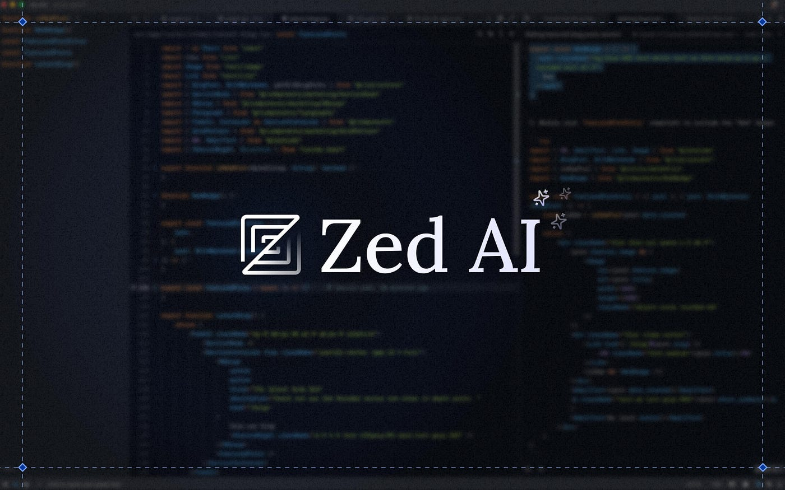
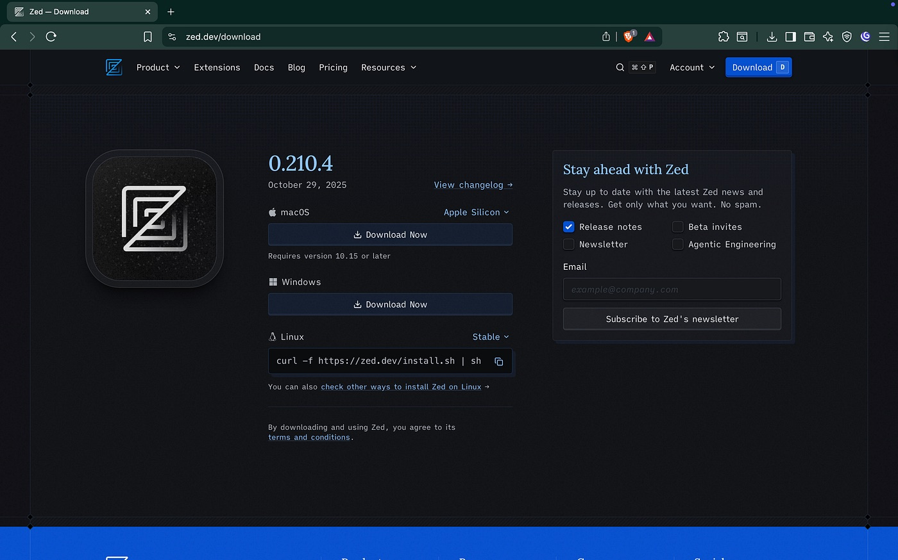
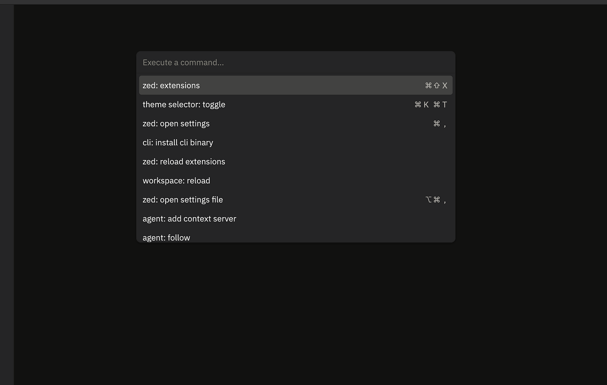
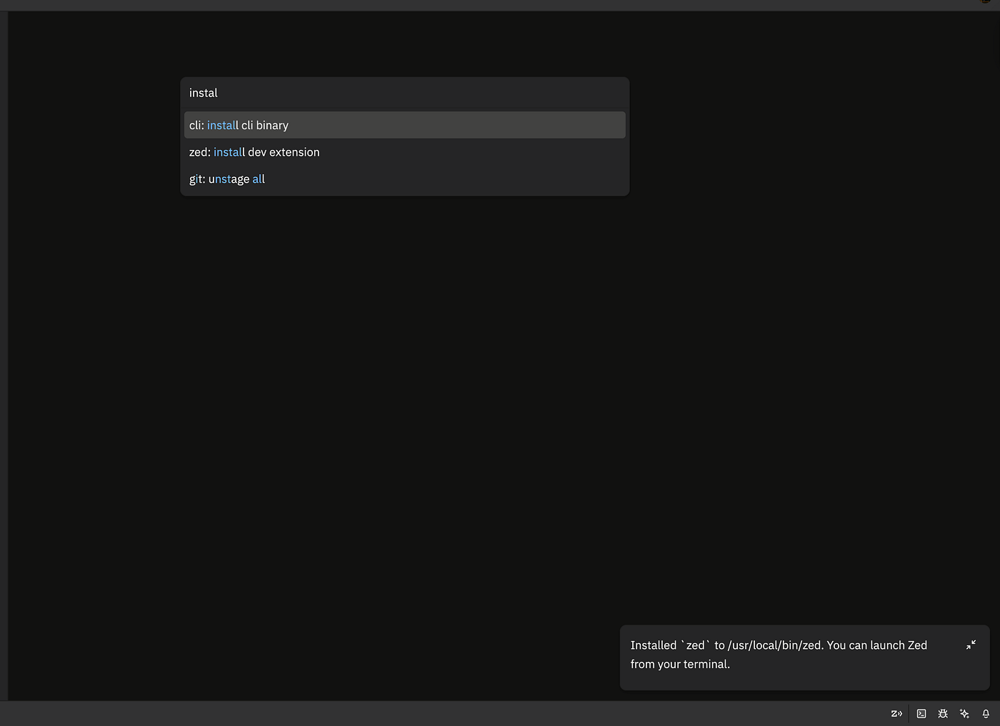
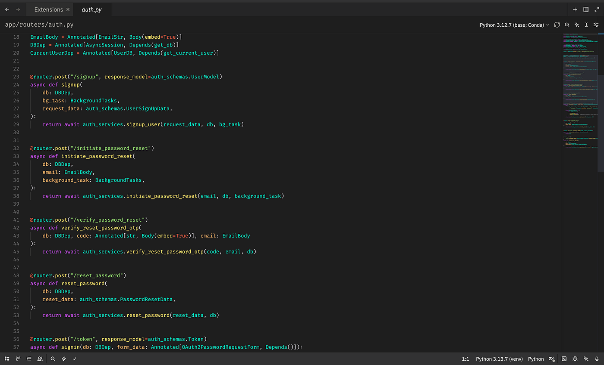

+++
title = "Zed: The Text Editor Reimagined for the Modern Developer"
date = 2025-11-05
description = "Why Zed might just change the way you write software."
draft = false

[extra]
toc = true
og_image = "cover.jpg"
+++

Why Zed might just change the way you write software.

## Guide to Setup and Configure Zed Editor

Why switching to Zed might improve your workflow as a developer.

As a developer, the text editor is the one software application you would spend most of your time crafting programs, scripts, and updating text related to software development. It is only reasonable that you get the most out of your primary text editor of choice.

## Why Zed!

- **It’s New, Modern, and Built for the Future:** Zed isn’t just another text editor; it’s a re-imagination of what a coding environment should feel like in the age of blazing-fast CPUs, cloud collaboration, and intelligent code assistance. Born from the creators of Atom (Atom was my first ever experience with text editors when I started programming).
- **It’s Very Fast :** Speed isn’t just a bragging right; it’s a philosophy. Zed is implemented in [**Rust**](https://rust-lang.org/), a language celebrated for its performance and safety. That means no Electron bloat, no sluggish startup, and no “fans going supersonic” moments. Opening large projects feels effortless. Searching across thousands of files happens in a blink. The editor responds to your typing as if it’s reading your mind; not your CPU cycles. Zed makes “instant” feel normal again.
- **It’s Open Source and Transparent**: [Zed’s source code](https://github.com/zed-industries/zed) is fully open on GitHub; transparent, hackable, and alive with community input. You can explore the internals, submit improvements, or simply watch the evolution of one of the most ambitious open-source editors in recent years. Unlike many modern tools that hide their logic behind corporate curtains. This is particularly interesting if you’re a Rust developer, since the Zed extension ecosystem is still young, you can write your own extension that would become the foundation for developers in a few years.
- **It’s Written in Rust; for Developers, by Developers:** By writing Zed entirely in Rust, the team didn’t just chase performance, they embraced correctness and safety. This foundation gives developers confidence that the tool they rely on most won’t buckle under pressure. Rust’s concurrency model also allows Zed to manage multiple tasks at once, background indexing, syntax parsing, and collaborative sessions, without skipping a beat. It’s not just fast; it’s *predictably* fast
- **It’s Simple, Beautiful, and Purposeful:** Zed’s interface is an ode to minimalism. It’s clean, distraction-free, and elegant without being sterile. No cluttered panes or noisy toolbars fighting for your attention. Every pixel has intent. Whether you’re working in a dark room late into the night or in a bright café, Zed’s design feels at home. The UI becomes an extension of your mind, just you and your code, nothig else.
- **It’s AI-centric**, integrates upcoming LLMs into your workflow to generate, transform, and analyze code. Where most editors treat AI as a plugin or novelty, Zed is building it into the heart of the workflow. It’s designed to integrate seamlessly with large language models (LLMs) to work with codes without breaking your flow.
- **it’s Built for Collaboration**: When I first experienced the add contact feature in Zed, I was wowed, it felt more like a social media for developers, and that gave me more reasons to adore the intentionality put into the development of the text editor.

If any of these attributes interest you just a little bit, just wait and see the comparison against a popular option.

## How does Zed compare against VSCode?

| Feature | VSCode | Zed |
|---|---|---|
| Startup time | ⚡ Slow (Electron) | ⚡⚡ Instant (Rust native) |
| Memory use | Heavy | Light |
| Collaboration | Extensions required | Built-in multiplayer |
| AI tools | Copilot | Native integration planned |
| UI/UX | Customizable but dense | Minimal and elegant |
| License | MIT | Open Source |
| Ecosystem | Matured | Young |

## Installation

If you do not already have Zed installed on your computer, follow this [link](https://zed.dev/download) to the Zed official page to download the version for your operating system. Currently, Zed supports macOS, Windows, and Linux.

After download and installation, you can proceed to start a new instance of the Zed Editor on your computer.

If you’re like me, coming from a VSCode background, you must understand the great ergonomics gotten from interacting with VSCode from the terminal and vice versa. This can be your reality too; in order to gain this ability, you would need to install the Zed CLI. An example of the benefits gained from installing the CLI is opening a directory from the terminal in Zed with a command like `zed .`.

### Install Zed CLI

On Linux, the Zed CLI should come with the Linux distribution’s Zed package, as seen from the download step above. On macOS, the CLI comes with the binary and can be installed into your system via the command palette.

I would focus on macOS for this guide, since I am using a Mac.

You can access Zed’s Command Palette, which is very similar to the command palette found in VSCode. You can open the command palette with the following key binding: `cmd + shift + p`

Searching the command palette for cli: install would show the command for installing the CLI.

### Choosing a Theme Extension

The minimalistic interface of the Zed editor can be greatly improved by choosing a theme that best aligns with your personality and self. For me, coming from VSCode and having worked with a certain shade of theme for a while, my go-to theme is this.

**Steps to install a theme extension**

- Open Command Palette with `cmd + shift + p`
- Select `zed: extension`
- Select Theme Tab
- Search for the Theme of your choice and install

Once you’ve installed a theme of your choosing, you can toggle between these themes using the `theme selector: toggle` command in the command palette.

I use [Colorizer](https://github.com/tamimhasandev/colorizer) for my local development, because it offers a vibrant color contrast look and feel to text.

*Screenshot showing the [Colorizer](https://github.com/tamimhasandev/colorizer) theme*

### Command Keys Bindings

- `cmd + shift + p`: opens the command palette for the text editor.
- `cmd + j`: Toggles the integrated terminal within the editor.
- `cmd + b`: Toggles the sidebar visibility.
- `cmd + k + 0`: Collapse all regions in the current active text file (code region refers to function bodies and block structures)
- `cmd + k + j`: Expand all regions in the current text editor. This is the opposite of the command above.
- `cmd + p`: Finds a file in the current working directory.
- `cmd + k + w:` Close all open tabs in the editor
- `cmd + shift + f:` Search all files in the current directory for text match

### Conclusion

Zed is still relatively new compared to matured editors like VSCode, so it’s still lacking some features that you might have seen in other text editors, regardless, for what it does have, it does them very. It was built with the pain point of modern developers in mind, it’s embraced AI to boost development rate and keeps the developer flow at all time high with little to no noise from the UI. I am still very new to Zed, But I do intend to make it my new best editor moving forward.
